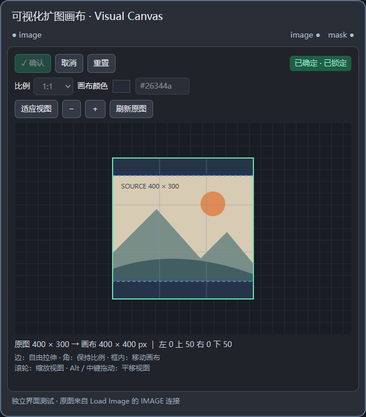

# 可视化扩图画布 · Visual Canvas

一个独立的 ComfyUI 扩图节点。图片从 ComfyUI 自带的 **加载图片 / Load Image** 节点输入；拖动白色画布框扩展图片，确认后锁定。不会修改或依赖 YCNodes 等其他插件。



## 安装

1. 解压 `ComfyUI-VisualCanvas.zip`。
2. 将里面的整个 `ComfyUI-VisualCanvas` 文件夹放进你实际使用的 ComfyUI 的 `custom_nodes` 文件夹。最终路径应为 `ComfyUI/custom_nodes/ComfyUI-VisualCanvas/__init__.py`，避免套两层同名文件夹。
3. 重启 ComfyUI，然后在浏览器按 **Ctrl + F5** 强制刷新。
4. 双击节点画布搜索 **VisualCanvasExpand** 或 **可视化扩图画布**。分类为 `image/Visual Canvas`。

不需要额外执行 pip 安装；只使用 ComfyUI 已有的 PyTorch 和浏览器原生功能。节点名称固定，保存的工作流和确认设置随插件版本升级保留。

## 连接与使用

```text
加载图片 IMAGE ──→ 可视化扩图画布 image ──→ 扩图工作流的图片输入
                                    mask ──→ 扩图工作流的遮罩输入
```

1. 在 **加载图片 / Load Image** 中上传图片，把 IMAGE 输出连到此节点的 `image` 输入。支持中间经过 Reroute。图片自动显示，无需运行此节点。
2. 选择常用比例，或直接拖动画布外框。原图蓝色虚线框固定，不缩放原图，也不会裁切原图。
3. 设置新增画布的颜色，可用颜色选择器或输入 `#RRGGBB`。
4. 点击 **确认**，状态显示 **已确定 · 已锁定**。之后正常运行工作流，无需重复确认。
5. 要改设置，点击 **取消**，修改后重新确认。要回到原图尺寸，点击 **重置**，再确认。

### 拖拽规则

| 操作 | 效果 |
| --- | --- |
| 拖动上、下、左、右的中点手柄 | 自由改变比例 |
| 拖动任意角手柄 | 保持拖动开始时的画布比例，固定对角 |
| 拖动画布框内部 | 移动画布相对原图的位置，改变四周扩展量 |
| 滚轮 / ＋ / − | 只缩放编辑器视图，不改变输出像素 |
| Alt + 左键拖动 / 中键拖动 | 平移编辑器视图 |
| 适应视图 | 让整个画布回到视野中 |

比例选项包含 **自由、原图、1:1、3:2、2:3、4:3、3:4、16:9、9:16**。比例预设生成完整包含原图的最小画布；之后仍可用边手柄改成其他比例，用角手柄按当前比例放大。整数像素取整可能造成不超过约一个像素的比例误差。

### 确认、取消、重置

- **确认**：将当前坐标、尺寸和颜色复制成已确认快照；锁住拖拽、比例和颜色。重复确认不会覆盖快照。
- **取消**：解除之前的确认，保留原确认框供继续编辑。再次确认会写入新快照，后端使用新结果。
- **重置**：解除确认，恢复当前输入图片的原始宽高和位置。保留已选择的画布颜色；原图尺寸时不会产生新增区域。
- **状态标**：待确认 / 已确定 / 已取消。状态、草稿和确认快照随工作流保存；请保存工作流以便重启后恢复。
- **未确认时运行**：节点报出中文提示并停止，不会悄悄输出未经确认的图像。

锁定的是**扩展设置**。运行时的原图内容仍来自 `image` 输入：换成同尺寸图片可复用已确认画布；换成不同尺寸的图片会保留旧确认并提示取消或重置，重新确认后才能运行。插件不冻结输入图片文件，也不会保存原图的 base64 数据到工作流。

## 输出

| 输出 | 内容 |
| --- | --- |
| `image` / IMAGE | 原图像素不变，周围填充指定 RGB 颜色 |
| `mask` / MASK | 新增区域为 **1（白色）**，原图区域为 **0（黑色）** |

支持批量 IMAGE，所有图片使用相同扩展几何，mask 的批次数与 image 一致。输出保持输入的设备与浮点数据类型。

画布尺寸由拖拽产生整数像素，不自动凑整到 8 或 64 的倍数；如后续模型要求特定倍数，可在后续节点处理。画布边长上限为 16384 像素，批次与画布的总像素上限为 64 × 1024 × 1024。

## 示例

将 `examples/basic-workflow.json` 拖入 ComfyUI，再在其加载图片节点上传 `examples/visual-canvas-sample.png` 或你自己的图片。调整画布并点击确认，运行后会预览扩展图和对应遮罩。`examples/api-prompt.json` 是使用已确认设置的 API 格式示例，便于自动化执行。

## 适用范围与故障处理

- 即时预览针对 ComfyUI 自带 `LoadImage`，支持透明 Reroute。其他图像处理节点和子图内连接尚未提供即时预览；请在加载图片之后使用此节点。
- 显示旧图时可点击 **刷新原图**，例如外部覆盖了同名输入文件。
- 提示尺寸变化时，点击 **取消** 或 **重置**，等待新图显示，再重新确认。
- 节点只有字符串输入、没有编辑区时，检查插件路径、重启服务并 Ctrl + F5；浏览器控制台中的 `[VisualCanvas]` 提示可用于排查。
- 请保留内部 `canvas_state` widget；不要把它转换成外部输入。

本版本已通过后端张量测试、前端几何与状态测试，以及真实 Chrome 中的扩展界面测试。浏览器测试使用模拟的 ComfyUI 图连接、静态扩展加载和 `/view` 接口；**没有在用户实际的 ComfyUI 安装中完成端到端验证**。插件使用 ComfyUI 官方的 `NODE_CLASS_MAPPINGS`、`WEB_DIRECTORY`、JavaScript 扩展钩子和 DOM widget 接口。

接口参考：[JavaScript 扩展](https://docs.comfy.org/custom-nodes/js/javascript_overview)、[IMAGE 与 MASK](https://docs.comfy.org/custom-nodes/backend/images_and_masks)、[DOM widget 实现](https://github.com/Comfy-Org/ComfyUI_frontend/blob/main/src/scripts/domWidget.ts)。

## 开发验证

```powershell
python -m unittest discover -s tests -p test_node.py -v
node --test tests/model.test.mjs
# UI 测试需安装 Playwright；可通过 VC_BROWSER_PATH 指定已有 Chrome/Edge。
node tests/ui.test.cjs
```

MIT License。
